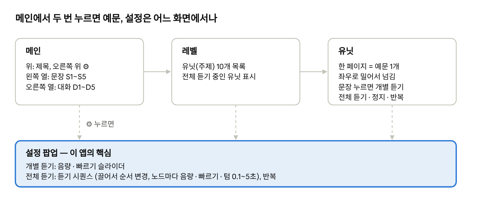
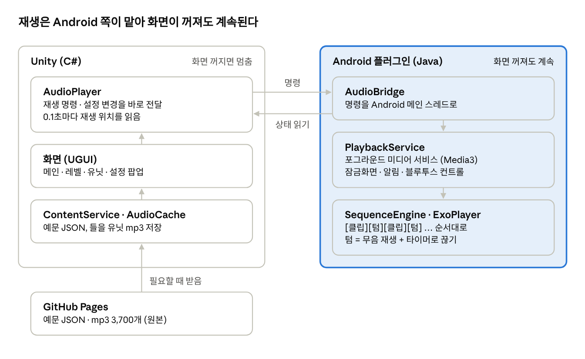

# 영어 말하기 앱 — 프로젝트 소개서

2026-10-07 기준 · 처음 보는 사람을 위한 요약 (원본 문서: [Claude Docs](https://claude.ai/code/artifact/f7489d42-a32b-47c1-bad8-2040f2af72ac))

## 한눈에 보기

**"듣고, 따라 말하고, 화면을 꺼놓고도 계속 들을 수 있는" 영어 말하기·대화 학습 앱**이다. Android 전용이고 Unity로 만든다.

- **대상:** 왕초보부터 1분 말하기까지, 이동 중이나 화면을 끈 채로 영어를 반복해서 듣고 싶은 한국어 사용자
- **콘텐츠:** 레벨 10개 × 유닛 10개 × 예문 5개 = 예문 500개. 예문마다 영어·한국어 문장과 영어·한국어 음성(mp3 3,700개)
- **핵심 기능:** 사용자가 직접 짜는 "듣기 시퀀스"(예: 한국어 → 영어 → 영어 → 한국어 → 영어)로 유닛 전체를 연속 재생하고, 화면이 꺼져도 계속 재생

| 영역 | 상태 |
| --- | --- |
| 콘텐츠·음성 (예문 500개, mp3 3,700개, 원격 배포) | 완료 |
| 앱 화면·설정·재생 코드 | 작성 완료, `main` 에 머지 |
| Unity 에디터·실기기 실행 확인 | 아직 안 함 (다음 단계) |
| 수면 타이머·진행률·출시 준비 | 남은 일 |

## 기획

학습은 **레벨 → 유닛(주제) → 예문** 3단 구조다. 하루 1유닛이면 100유닛을 약 3개월에 끝낸다.

| 레벨 | 문장(말하기) 트랙 | 대화 트랙 (A·B 두 화자) |
| --- | --- | --- |
| 1 왕초보 | S1: 1~3 단어 | D1: 2턴 |
| 2 초급 | S2: 4~6 단어 | D2: 4턴 |
| 3 중급 | S3: 8~12 단어 | D3: 6턴 |
| 4 중상급 | S4: 2~3 문장 | D4: 8턴 |
| 5 1분 | S5: 90~110 단어 | D5: 12턴 |

레벨마다 주제별 유닛 10개(예: S2 → 여행 첫걸음, 자기소개, 가족 …), 유닛마다 예문 5개가 있다.

### 핵심 요구사항

- 예문마다 영어 문장 / 한국어 해석 / 영어 음성 / 한국어 음성
- 플레이리스트처럼 연속 재생, **화면을 꺼도 재생 유지** (잠금화면·알림 컨트롤 포함)
- 세로 모드만, 노치·제스처 바 등 Safe Area 를 넘지 않는 UI
- 듣는 방식(언어 순서·반복·음량·빠르기·쉬는 시간)을 사용자가 직접 정함
- 앱 업데이트 없이 예문을 고칠 수 있어야 함

### 주요 결정과 이유

| 결정 | 이유 |
| --- | --- |
| 엔진: Unity + Android 네이티브 재생 플러그인 | Unity 는 화면이 꺼지면 멈추므로, 재생만 Android 표준 미디어 서비스에 맡김 |
| 음성: 미리 만든 mp3 (TTS Supertonic-3) | 기기마다 음질이 같고, 오프라인·백그라운드 재생이 가장 단순함. 비용 0원 |
| 예문·mp3 는 GitHub Pages 에서 원격으로 | 배포 후에도 앱 업데이트 없이 문장·음성을 고침 |
| 들을 유닛의 mp3 만 받아 캐시 | GitHub Pages 월 트래픽 한도(약 100GB) 안에서 운영 |
| 고정 재생 패턴 대신 "듣기 시퀀스" | 영→한, 한→영, 영×2→한 등 모든 패턴을 하나의 기능으로 만들 수 있음 |
| 대화는 대사(턴)마다 시퀀스 적용 | 말하기의 "문장 1개"와 같은 단위로 다룸 |
| 폰트: 잘난체 고딕 (외곽선 0.15) | 무료·상업 이용 가능, 한글·영문·기호를 모두 포함 |

## 화면 구성과 흐름

메인 → 레벨 → 유닛 세 화면이 차례로 이어지고, 설정 팝업은 어느 화면에서나 오른쪽 위 ⚙ 로 연다.

- **세로 모드만** 지원하고, 모든 버튼·글자는 노치·펀치홀·하단 제스처 바를 피한 Safe Area 안쪽에 둔다
- 메인의 2열은 화면 가운데보다 조금 위에서 시작해 아래로 내려간다. 버튼마다 레벨 코드(S1), 이름(왕초보 말하기), 분량(1~3 단어)
- 유닛 화면 아래에는 페이지 이동(◀ 1/5 ▶), 듣기 순서 칩(한 영 영 한 영 — 지금 재생 중인 것 강조), 재생 버튼이 있다
- 대화 예문은 채팅처럼 A 는 왼쪽, B 는 오른쪽 말풍선. 전체 듣기 중에는 지금 대사를 노란색으로 표시하고 자동으로 스크롤
- 전체 듣기 중 메인·레벨 화면으로 나가면 아래에 **미니 플레이어**가 뜨고, 누르면 그 유닛으로 돌아간다
- 뒤로 가기: 팝업 닫기 → 이전 화면 → 메인에서는 앱을 끄지 않고 뒤로 보냄 (재생 유지)
- 폰트는 잘난체 고딕 + 검은 외곽선 0.15, 기준 해상도 1080 × 1920

## 듣기 기능

듣는 방법은 두 가지다. 두 방법 모두 **설정 슬라이더를 움직이는 즉시 지금 나는 소리에 적용**된다.

| | 개별 듣기 | 전체 듣기 |
| --- | --- | --- |
| 무엇을 | 문장(대화는 대사) 하나, 한 언어 | 유닛의 예문 5개 전부, 이어서 |
| 시작 | 문장을 누르거나 ▶ 영어 / ▶ 한국어 | 유닛 화면 아래 "전체 듣기" |
| 설정 | 음량, 빠르기 1개씩 | 듣기 시퀀스 (노드마다 언어·음량·빠르기·텀), 반복 |
| 화면 꺼짐 | 짧아서 해당 없음 | 끝까지 계속 재생 |

### 듣기 시퀀스

예문 하나(대화는 대사 하나)를 어떤 순서로 몇 번 들을지 정한 목록이다. 목록의 한 줄을 "노드"라고 부른다.

| 순서 | 언어 | 음량 | 빠르기 | 텀(초) |
| --- | --- | --- | --- | --- |
| 1 | 한국어 | 100% | x1.0 | 1.0 |
| 2 | 영어 | 100% | x1.0 | 1.5 |
| 3 | 영어 | 100% | x1.0 | 1.5 |
| 4 | 한국어 | 100% | x1.0 | 1.0 |
| 5 | 영어 | 100% | x1.0 | 2.0 |

위가 기본값이다. 예문 5개 유닛이면 이 5단계가 예문마다 반복돼 총 25번 소리가 난다.

- **순서:** 줄 왼쪽 ≡ 손잡이를 끌어서 바꾼다
- **언어:** 영어/한국어 버튼을 누르면 바뀐다
- **추가·삭제:** "+ 영어 듣기" / "+ 한국어 듣기", 줄의 × (1~10개)
- **값:** 줄을 펼치면 슬라이더 3개 — 음량 0~100%, 빠르기 x0.5~x2.0 (0.05 단위), 텀 0.1~5.0초 (0.1 단위)
- **텀:** 그 노드를 재생한 뒤 다음 소리까지 쉬는 시간 (따라 말하기용)
- **반복:** 켜면 유닛이 끝난 뒤 처음부터 다시

### 재생 중에 바꾸면

- 음량·빠르기: 지금 나는 소리에 바로 반영
- 텀: 진행 중인 텀의 남은 시간도 바로 다시 계산
- 순서·추가·삭제·언어: 지금 예문부터 새 시퀀스로 다시 재생 (일시정지 중이었으면 일시정지 유지)
- 설정 팝업 위쪽에 "재생 중" 카드와 재생/일시정지 버튼이 있고, 지금 재생 중인 노드는 노란색으로 표시된다 → 들으면서 바로 조절
- 설정은 기기에 저장돼 앱을 다시 켜도 유지

## 기술 구조

Unity 는 화면이 꺼지거나 앱이 뒤로 가면 멈춘다. 그래서 **화면과 학습 로직은 Unity, 실제 소리 재생은 Android 표준 미디어 서비스**가 맡는다.

### 화면이 꺼져도 끊기지 않는 이유

- Unity 는 들을 순서를 모두 펼친 목록(예: 예문 5개 × 노드 5개 = 25단계)을 한 번에 넘긴다. 그 뒤로는 Unity 가 멈춰도 Android 쪽이 끝까지 재생한다
- 재생은 Media3(구글 공식 미디어 라이브러리)의 **포그라운드 서비스** 안에서 돌아간다 — 음악 앱과 같은 방식이라 잠금화면·알림 컨트롤, 전화 수신 시 일시정지, 이어폰 분리 시 일시정지가 기본으로 된다
- 문장 사이 텀도 "무음 파일을 재생"하면서 정한 시간에 끊는다. 텀 동안에도 플레이어가 "재생 중" 이라 안드로이드가 서비스나 CPU 를 재우지 않는다
- 알림의 이전/다음 버튼은 예문 단위로 이동

### 설정을 바꾸면 바로 들리는 이유

- 슬라이더를 움직이면 그 노드의 새 값만 플러그인으로 보낸다 (목록을 다시 만들지 않음)
- 플러그인은 지금 나는 소리가 그 노드면 음량·빠르기를 즉시 바꾸고, 진행 중인 텀이면 남은 시간을 다시 계산한다
- 빠르기를 바꿔도 음높이는 그대로다 (에디터의 대체 재생기는 음높이도 바뀜)

### 화면과 재생을 맞추는 방법

Unity 는 0.1초마다 플러그인에 "지금 몇 번째를 재생 중인지" 묻는다. 화면이 꺼져 있는 동안 Unity 는 아무것도 못 받지만, 다시 켜지면 바로 현재 예문·대사·노드로 화면이 맞춰진다.

| 영역 | 기술 |
| --- | --- |
| 엔진 | Unity 6000.3.17f1, C#, UGUI + TextMeshPro |
| 재생 | Java, AndroidX Media3 1.4.1 (ExoPlayer + MediaSessionService) |
| 최소 사양 | Android 8.0 (API 26) 이상, 64비트(ARM64) |
| 저장 | 설정 = 기기 내 저장(PlayerPrefs), 예문·mp3 = 앱 전용 폴더 캐시 |

## 콘텐츠와 음성

예문과 음성의 원본은 GitHub Pages(`didrnrgus.github.io/project_speaking_english/`)에 있고, 앱은 실행할 때 받아서 쓴다. 그래서 문장을 고칠 때 앱을 다시 출시할 필요가 없다.

### 파일

| 파일 | 내용 | 개수 |
| --- | --- | --- |
| `index.json` | 레벨·유닛 목록 (앱이 가장 먼저 읽음) | 1 |
| `speaking/s1/u01.json` … | 말하기 유닛: 예문마다 `en`, `ko`, `audio` 경로 | 50 |
| `dialogue/d1/u01.json` … | 대화 유닛: 예문마다 `topic` + 턴별 화자·`en`·`ko`·`audio` | 50 |
| `audio/en/S2/S2-U01-01.mp3` … | 영어·한국어 음성 (대화는 턴별 `_t1`, `_t2` …) | 3,700 (약 111MB) |

유닛 파일마다 `version` 번호가 있다. 문장을 고치면 1 올리고, 앱은 이 번호가 바뀐 유닛의 mp3 를 다시 받는다.

### 음성 만들기

- 엔진: Supertone **Supertonic-3** (로컬 실행, 무료, 상업 이용 가능)
- 목소리: 말하기 = 여성 F1, 대화 = A 여성 F1 / B 남성 M1. 영어·한국어 같은 목소리, 64kbps 모노
- 속도 1.0 한 벌만 만들고, 빠르게·느리게는 앱에서 조절
- `tools/generate_tts.py` 가 바뀐 문장의 mp3 만 다시 만들고, `tools/validate_content.py` 가 파일 구조·누락을 검사
- 라이선스상 **AI 생성 음성임을 고지**해야 함 (앱 정보·스토어 설명, 출시 전)

### 앱이 받는 순서

1. 예문 JSON: 원격 → 실패하거나 오프라인이면 기기 캐시 → 그마저 없으면 앱에 들어 있는 번들 복사본
2. 원격에서 받은 파일은 검사를 통과해야 캐시에 저장 (깨진 파일은 버리고 이전 내용 유지)
3. mp3: **들을 유닛의 파일만** 동시에 4개씩 받아 기기에 저장 — 전체를 한꺼번에 받지 않음 (트래픽 한도)

트래픽 여유: 유닛당 평균 약 1.1MB, 하루 1유닛이면 사용자당 월 약 33MB → 월 활성 사용자 약 3,000명까지 GitHub Pages 한도 안 (대략치).

## 코드 구조와 시작 방법

레포는 [didrnrgus/english-speaking-app](https://github.com/didrnrgus/english-speaking-app) 이고, 앱은 `unity/` 폴더에 있다. 화면 모양은 프리팹(`Assets/UI/Prefabs/`)에 있고 코드는 데이터만 채운다 — 에디터에서 보고 바로 고칠 수 있다. UI 는 리퀴드 글래스(Le Tai Translucent Image + Paraform) 기반.

| 위치 | 하는 일 |
| --- | --- |
| `unity/Assets/Scripts/Core/` | 앱 시작점(AppRoot), 예문 로드, mp3 캐시, 설정 저장 |
| `unity/Assets/Scripts/Audio/` | 재생 제어(AudioPlayer), Android 연동, 에디터용 대체 재생 |
| `unity/Assets/Scripts/UI/` | 색·폰트·아이콘, 화면 4개(메인·레벨·유닛·설정), 위젯(페이지 넘김, 슬라이더, 드래그 목록 등) |
| `unity/Assets/Plugins/Android/EnglishAudio.androidlib/` | 화면 꺼짐 재생 플러그인 (Java, Media3) |
| `unity/Assets/Editor/` | 처음 열 때 자동 셋업, 빌드 전 예문 복사, Gradle 보정 |
| `content/` | 앱에 넣을 번들 예문 JSON (원격 원본의 복사본) |
| `tools/` | 음성 생성(`generate_tts.py`), 예문 검사(`validate_content.py`) |
| `docs/` | 기획서(PLAN), 구현 설명(UNITY), 작업 기록(WORKLOG), 음성 기록(AUDIO), 유닛 목록(CURRICULUM), 이 소개서(OVERVIEW) |

### 처음 열기

1. Unity Hub → Add → Add project from disk → `unity/` (에디터 6000.3.17f1, Android Build Support 포함)
2. 자동 셋업이 한 번 실행된다: TextMeshPro 리소스, 폰트 에셋, 번들 예문 복사, 세로 고정·패키지명(`com.didrnrgus.englishspeaking`)·minSdk 26·IL2CPP/ARM64, `Main` 씬 (다시: `Tools > English App > Run Project Setup`)
3. 셋업이 만든 `ProjectSettings/`, `.meta`, 폰트 에셋, 씬을 커밋
4. Build Profiles → Android → Play(에디터) / Build(기기)

에디터에서는 화면 꺼짐 재생을 확인할 수 없다. 같은 규칙으로 도는 대체 재생기가 돌고, 빠르기를 바꾸면 음높이도 같이 바뀐다 (기기에서는 음높이 유지).

## 검증 상태와 남은 일

코드는 컴파일 검사만 통과했고, **Unity 에디터·실기기에서는 아직 실행하지 않았다.** 작업 환경에 Unity 가 없었기 때문이다.

| 검사 | 방법 | 결과 |
| --- | --- | --- |
| C# 코드 | Unity 참조 DLL + UGUI/TextMeshPro 형태만 흉내 낸 대체 정의로 mono 컴파일 (에디터·Android·PC 3가지) | 오류 0 |
| Java 플러그인 | Media3 1.4.1 실제 소스 + Android 14 프레임워크로 javac | 오류 0 |
| 화면 모양·터치 | 실행 필요 | 미확인 |
| 화면 꺼짐 재생·잠금화면 컨트롤 | 실기기 필요 | 미확인 |

UGUI/TextMeshPro 는 형태만 흉내 낸 것이라, Unity 6 에서 이름이 바뀐 함수가 있으면 처음 열 때 오류가 날 수 있다.

### 알려진 한계

- 앱을 최근 앱 목록에서 밀어서 지우면 재생이 멈춘다 (Unity 가 액티비티 onDestroy 에서 프로세스를 죽임 — 확인됨). 그 직전에 재생 알림·미디어 카드를 지운다. 화면 끄기·홈 버튼·뒤로 가기에서는 계속 재생된다
- 삼성·샤오미 등 제조사 절전 정책에서 장시간 재생은 미확인
- S5·D5 "1분" 레벨의 실제 영어 재생 길이는 약 34초(중앙값) — 분량을 늘릴지 이름을 바꿀지 결정 필요

### 남은 일

- [ ] Unity 에디터에서 처음 열기 → 콘솔 오류 수정
- [ ] 실기기 테스트: 화면 꺼짐 재생, 잠금화면 컨트롤, 전화·이어폰 분리 시 일시정지 (체크리스트: `docs/UNITY.md` 7장)
- [ ] 수면 타이머, 진행률·오늘의 유닛, 텍스트 크기
- [ ] 최근 앱 목록에서 지워도 재생 유지 (재생 서비스를 별도 프로세스로)
- [ ] 배터리 최적화 안내, 제조사별 테스트
- [ ] 출시 준비: AI 음성 고지 문구, 아이콘·스토어 자료, 예문 원어민 감수(권장)
