# 🎧 영어 말하기 앱 — 화면을 꺼도 계속 듣는 Unity 학습 앱

> **"듣고, 따라 말하고, 화면을 꺼놓고도 계속 들을 수 있는"** 레벨별 영어 말하기·대화 학습 앱.
> Unity로 UI·학습 로직을 만들고, Unity가 멈추는 백그라운드 재생은 **Android(Media3)·iOS(AVAudioEngine) 네이티브 플러그인**을 직접 만들어 해결했습니다.
> 기획 · 콘텐츠 500개 · TTS 음성 3,700개 · 클라이언트 · 네이티브 · CI 까지 **1인 개발**.

---

## 프로젝트 개요

| 항목 | 내용 |
| --- | --- |
| 기간 | 2026.10 ~ 진행 중 (현재 v0.1.3) |
| 인원 | 1인 (기획 · 콘텐츠 · 개발 · 배포) |
| 플랫폼 | Android 출시 목표 · iOS 실기기 설치·동작 확인 (스토어 배포 X) |
| 엔진 / 언어 | Unity 6 (6000.3) · C# · UGUI + TextMeshPro |
| 네이티브 | Java — AndroidX Media3 (ExoPlayer, MediaSessionService) · Objective-C++ — AVAudioEngine |
| 콘텐츠 / 인프라 | Python (Supertonic-3 로컬 TTS) · GitHub Pages (정적 호스팅) · GitHub Actions (iOS 빌드) |
| 광고 | Unity LevelPlay 적응형 배너 |
| 코드 규모 | C# 약 8,200줄 · Java 약 940줄 · Objective-C++ 약 780줄 · Python 약 250줄 · CI 약 220줄 |

---

## 📸 스크린샷

> 모두 iPhone 실기기에서 촬영 (v0.1.3)

### 메인 — 밝은 / 어두운 테마

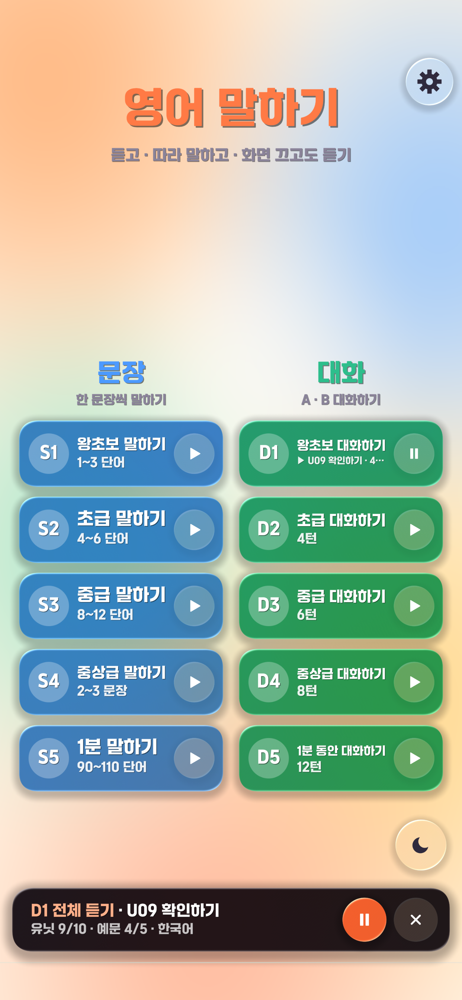

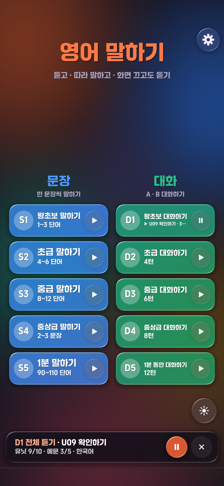

- 왼쪽 열은 문장 S1~S5, 오른쪽 열은 대화 D1~D5 레벨 카드. 카드 오른쪽 ▶ 를 누르면 **레벨 전체 듣기**가 시작돼요
- 지금 듣는 레벨 카드에는 진행 중인 유닛이 표시되고 ▶ 가 ⏸ 로 바뀌어요 (D1 카드: "▶ U09 확인하기")
- 아래 **미니 플레이어**에는 "D1 전체 듣기 · U09 확인하기 / 유닛 9/10 · 예문 4/5 · 한국어"처럼 어떤 범위를 어디까지 들었는지 표시돼요
- 오른쪽 아래 버튼으로 밝은/어두운 테마를 바꿔요

### 레벨 → 유닛

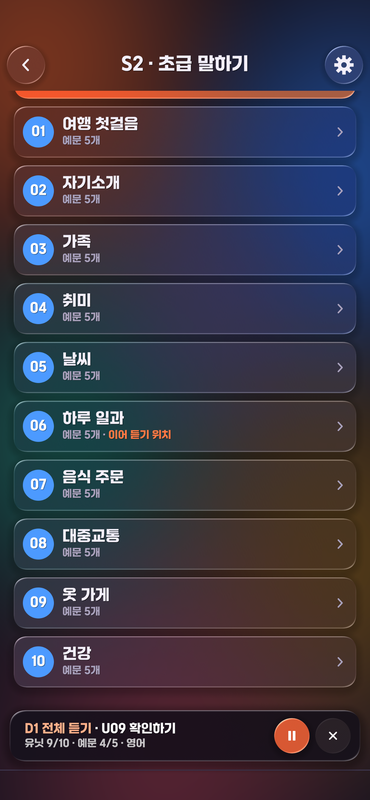

- 주제별 유닛 10개 (여행 첫걸음, 자기소개, 가족 …). 마지막으로 듣던 유닛에는 "이어 듣기 위치"가 표시돼요

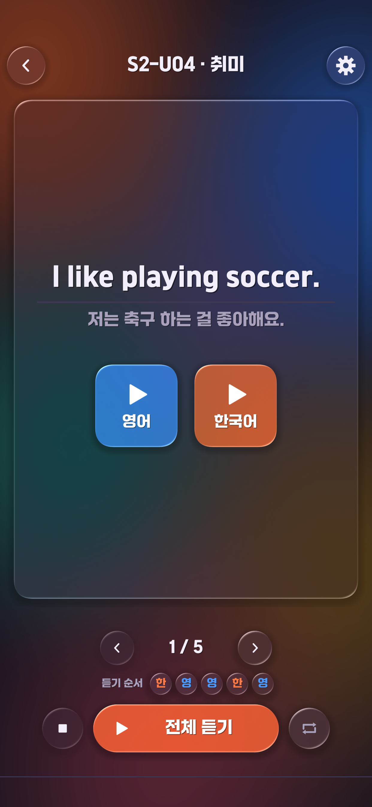

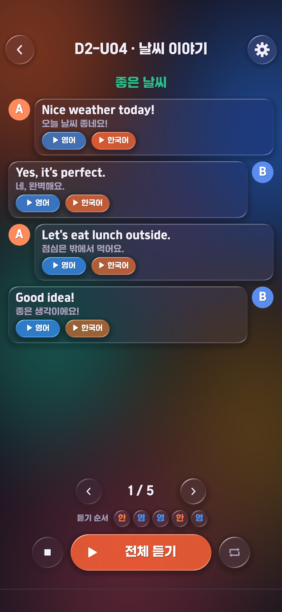

- 한 페이지에 예문 1개 (◀ 1/5 ▶). 문장마다 ▶ 영어 / ▶ 한국어로 개별 듣기를 해요
- 대화는 A 왼쪽, B 오른쪽 말풍선이고 대사마다 따로 들을 수 있어요
- 아래쪽 **듣기 순서 칩**(한 영 영 한 영)은 지금 재생 중인 노드를 강조하고, 옆에 정지 · 전체 듣기 · 반복 버튼이 있어요

### 설정 — 개별 듣기 / 듣기 시퀀스 / 한번에 설정

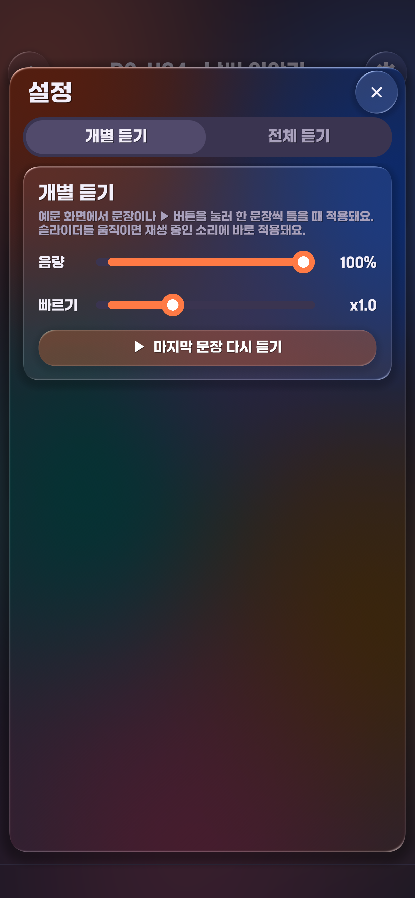

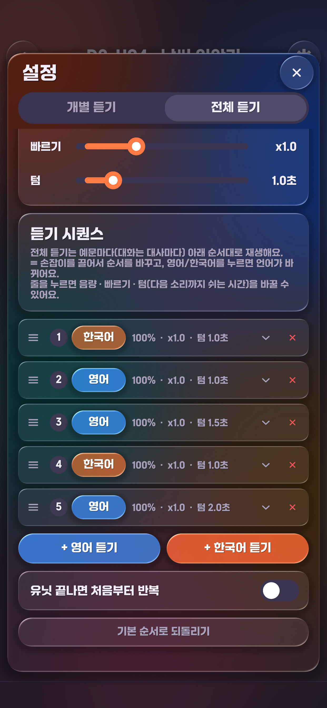

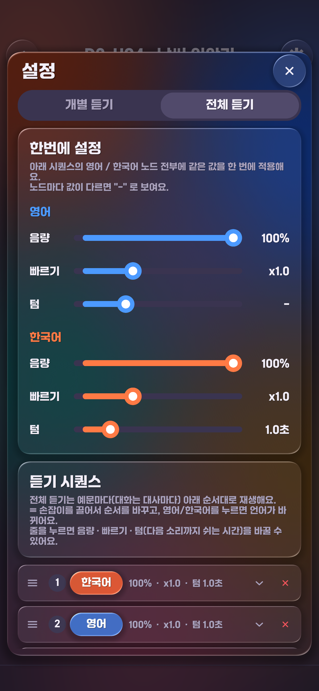

- **개별 듣기:** 음량 · 빠르기 슬라이더, "마지막 문장 다시 듣기"
- **듣기 시퀀스:** ≡ 손잡이를 끌어서 순서를 바꾸고, 언어 버튼을 눌러 영어/한국어를 바꿔요. 줄을 펼치면 음량 · 빠르기 · 텀 슬라이더가 나와요. "+ 영어 듣기 / + 한국어 듣기"로 노드를 추가하고, 유닛 반복과 기본 순서 되돌리기도 있어요
- **한번에 설정:** 영어 노드 전부 / 한국어 노드 전부에 같은 값을 적용해요. 노드마다 값이 다르면 그 항목은 "-"로 보여요 (영어 텀)

### 화면이 꺼져도 재생 — 잠금화면 컨트롤

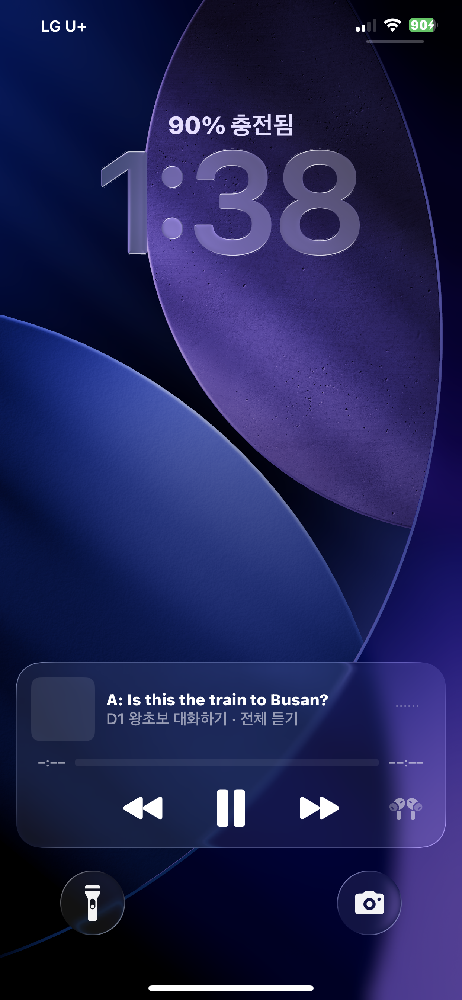

- 화면이 꺼진 iPhone 잠금화면에서도 재생이 이어지고, 지금 대사("A: Is this the train to Busan?")와 "D1 왕초보 대화하기 · 전체 듣기"가 표시돼요. 이전/다음은 예문 단위로 이동해요

---

## 어떤 앱인가

- **콘텐츠** — 5단계 난이도 × 2트랙(말하기 / 대화) = 10레벨, 레벨마다 주제별 유닛 10개, 유닛마다 예문 5개 → **예문 500개** (하루 1유닛이면 약 3개월). 예문마다 영어·한국어 문장과 영어·한국어 음성.

  | 레벨 | 말하기 | 대화 (A·B 두 화자) |
  | --- | --- | --- |
  | 1 왕초보 | 1~3 단어 | 2턴 |
  | 2 초급 | 4~6 단어 | 4턴 |
  | 3 중급 | 8~12 단어 | 6턴 |
  | 4 중상급 | 2~3 문장 | 8턴 |
  | 5 1분 | 90~110 단어 | 12턴 |

- **듣기 시퀀스** — "한 → 영 → 영 → 한 → 영"처럼 예문 하나를 어떤 순서로 몇 번 들을지 사용자가 직접 짭니다. 노드(한 줄)마다 언어 · 음량 · 빠르기(x0.5~x2.0) · 텀(따라 말할 쉬는 시간 0.1~5초)을 정하고, 드래그로 순서를 바꿉니다. 영→한, 한→영, 영×2→한 같은 고정 패턴을 따로 만들지 않고 **하나의 기능으로 모든 패턴**을 표현합니다.
- **세 가지 듣기** — 개별 듣기(문장 하나) / 유닛 전체 듣기(예문 5개) / 레벨 전체 듣기(유닛 10개 연속, 마지막으로 듣던 유닛부터).
- **화면을 꺼도 재생** — 잠금화면·알림 컨트롤, 전화 수신·이어폰 분리 시 자동 일시정지.
- **재생 중 즉시 반영** — 슬라이더를 움직이면 지금 나는 소리의 음량·빠르기, 진행 중인 텀의 남은 시간이 바로 바뀝니다.

---

## 시스템 구조

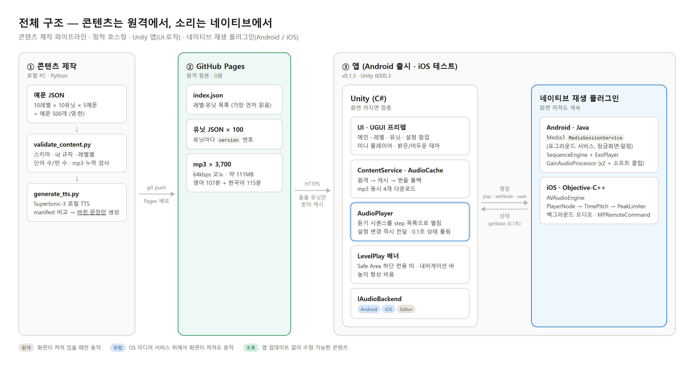

세 부분으로 나눴습니다.

1. **콘텐츠 제작 (로컬 PC, Python)** — 예문 JSON을 검사하고 로컬 TTS로 mp3를 만듭니다.
2. **GitHub Pages** — 예문 JSON과 mp3의 원본. 앱 업데이트 없이 문장·음성을 고칠 수 있습니다.
3. **앱** — Unity(C#)는 화면과 학습 로직, 네이티브 플러그인은 실제 소리 재생을 맡습니다. 둘은 "명령"과 "상태 읽기" 두 방향으로만 이야기합니다.

---

## 기술적 도전과 해결

### 1. Unity는 화면이 꺼지면 멈춘다 → 재생을 네이티브 미디어 서비스로 분리

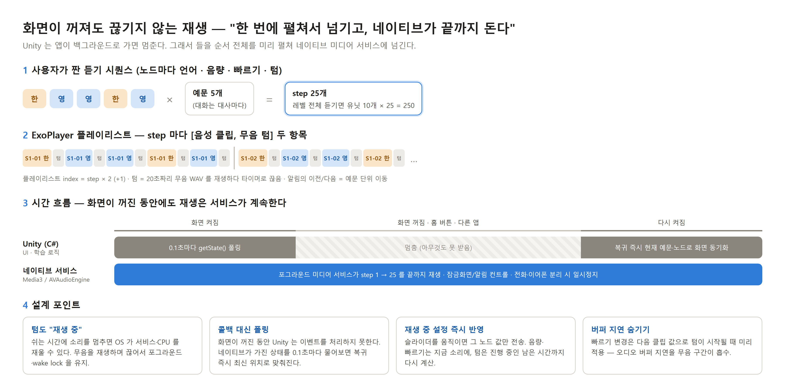

**문제** — Unity는 앱이 백그라운드로 가거나 화면이 꺼지면 메인 루프와 오디오가 멈춥니다. "화면을 꺼놓고 듣는" 핵심 기능이 Unity만으로는 불가능했습니다.

**해결**
- **역할 분리** — Unity는 UI와 "무엇을 들을지"만 정하고, 실제 재생은 Android **Media3 `MediaSessionService`(포그라운드 서비스) + ExoPlayer**, iOS **AVAudioEngine + 백그라운드 오디오 모드**가 맡도록 네이티브 플러그인을 직접 작성했습니다.
- **한 번에 펼쳐서 넘기기** — 듣기 시퀀스(노드 5개) × 예문 5개를 **step 25개짜리 목록으로 펼쳐** 한 번에 넘깁니다. 이후 Unity가 멈춰도 네이티브가 끝까지 재생합니다.
- **텀도 "재생 중"으로** — 쉬는 시간에 소리를 멈추면 OS가 서비스·CPU를 재울 수 있습니다. step마다 [음성 클립, 무음 WAV] 두 항목을 플레이리스트에 넣고, 무음을 재생하다 타이머로 끊어 포그라운드 상태와 wake lock을 유지했습니다. iOS도 같은 이유로 무음을 반복 재생합니다 (소리를 멈추면 iOS가 백그라운드 앱을 정지).
- **콜백 대신 0.1초 폴링** — 화면이 꺼진 동안 Unity는 이벤트를 처리하지 못합니다. 네이티브가 가진 상태(몇 번째 step, 어느 노드)를 Unity가 0.1초마다 물어보게 해서, 화면이 다시 켜지는 순간 현재 예문·대사·노드로 화면이 맞춰집니다.

**결과** — 음악 앱과 같은 구조라 잠금화면·알림 컨트롤, 전화 수신·이어폰 분리 시 일시정지가 OS 기본 동작으로 따라왔습니다. 알림의 이전/다음은 예문 단위로 이동합니다.

### 2. 재생 중에 설정을 바꾸면 "지금 나는 소리"에 바로 반영

**문제** — 사용자가 들으면서 빠르기·텀을 조절하는데, 목록을 다시 만들어 넘기면 재생이 끊기고 위치가 틀어집니다.

**해결**
- 슬라이더를 움직이면 **그 노드의 새 값만** 플러그인으로 보냅니다 (목록 재생성 X).
- 플러그인은 지금 재생 중인 클립이 그 노드면 음량·빠르기를 즉시 바꾸고, 진행 중인 텀이면 **남은 시간을 다시 계산**합니다.
- 빠르기 변경은 오디오 버퍼 때문에 약간 늦게 들리는데, 다음 클립의 빠르기를 **텀이 시작될 때 미리 적용**해서 지연을 무음 구간이 흡수하게 했습니다. 빠르기를 바꿔도 음높이는 유지됩니다.
- 순서·추가·삭제·언어처럼 구조가 바뀌면 지금 예문부터 새 시퀀스로 다시 재생합니다 (일시정지 중이었으면 일시정지 유지).

### 3. 앱 업데이트 없이 예문을 고치고, 무료 호스팅 한도 안에서 운영

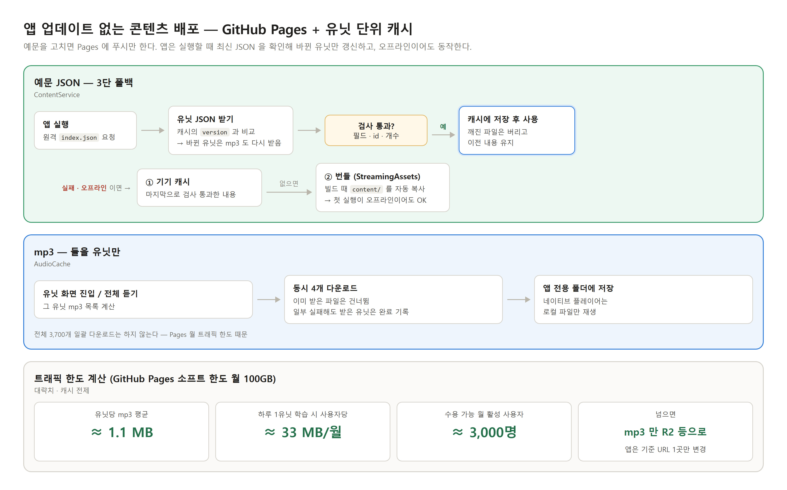

**문제** — 출시 뒤에도 오타·어색한 문장을 고쳐야 하는데, 매번 스토어 심사를 거치고 싶지 않았습니다. 서버 비용은 0원이어야 했습니다.

**해결**
- 예문 JSON과 mp3의 원본을 **GitHub Pages**에 두고, 유닛 파일마다 `version`을 붙였습니다. 앱은 실행할 때 최신 JSON을 확인해 버전이 바뀐 유닛만 캐시를 갱신하고, 그 유닛의 mp3를 다시 받습니다.
- **3단 폴백** — 원격 → 기기 캐시 → 빌드에 포함된 번들 순. 원격에서 받은 파일은 **검사를 통과해야만** 캐시에 저장해서, 깨진 파일이 올라가도 이전 내용으로 동작합니다. 번들 복사는 빌드 때 에디터 스크립트가 자동으로 합니다.
- **들을 유닛의 mp3만** 동시 4개씩 받아 캐시합니다. 전체(3,700개, 약 111MB) 일괄 다운로드를 하지 않아, Pages 월 트래픽 한도(약 100GB) 기준 **월 활성 사용자 약 3,000명**까지 비용 없이 운영할 수 있다고 계산했습니다.
- 원격 기준 URL을 한 곳에 모아 두어, 사용자가 늘면 mp3만 다른 저장소로 옮기고 URL 하나만 바꾸면 됩니다.
- mp3는 Git LFS를 쓰지 않았습니다 — GitHub Pages는 LFS 파일 대신 포인터 텍스트를 내보내기 때문입니다.

### 4. 하나의 재생 규칙, 플랫폼별 백엔드

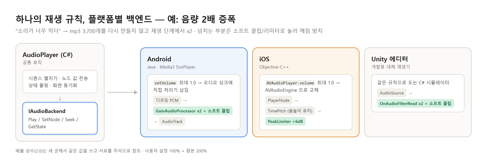

**구조** — 공통 로직(`AudioPlayer`)은 `IAudioBackend` 인터페이스(Play / SetNode / Seek / GetState)만 알고, Android · iOS · Unity 에디터 구현이 각각 붙습니다. 에디터에서는 같은 규칙으로 도는 C# 대체 재생기로 기기 없이 화면·흐름을 확인합니다.

**사례: "소리가 너무 작다"** — mp3 3,700개를 다시 만들지 않고 재생 단계에서 2배로 키웠습니다. 하지만 세 플랫폼 모두 플레이어 볼륨이 1.0이 최대였습니다.
- **Android** — ExoPlayer 오디오 싱크에 직접 만든 `GainAudioProcessor`를 넣어 디코딩된 PCM에 x2 + 소프트 클립.
- **iOS** — `AVAudioPlayer`로는 키울 수 없어 **AVAudioEngine으로 교체** (PlayerNode → TimePitch(음높이 유지) → PeakLimiter +6dB).
- **에디터** — `OnAudioFilterRead`에서 x2 + 소프트 클립.

넘치는 부분은 리미터/소프트 클립으로 눌러 깨짐을 막고, 배율 상수는 세 곳이 같은 값을 쓰도록 주석으로 서로 연결했습니다.

### 5. 레벨 전체 듣기 — 네이티브 코드 수정 없이 기능 확장

유닛 10개를 이어서 듣는 기능을 추가할 때, 유닛마다 Unity가 다음 유닛을 넘겨주면 **화면이 꺼진 동안 Unity가 멈춰 있어서 다음 유닛으로 넘어가지 못합니다.**
→ 레벨의 유닛 JSON·mp3를 **모두 받은 뒤 하나의 시퀀스(최대 step 250개)로** 넘기고, 페이지 번호를 레벨 전체에서 이어지는 번호로 매겨 알림의 이전/다음이 유닛 경계를 넘도록 했습니다. 1번의 "펼쳐서 넘긴다" 구조 덕분에 **네이티브 코드는 한 줄도 바꾸지 않았습니다.** 레벨마다 마지막으로 듣던 유닛을 저장해 이어 듣기를 지원하고, 화면마다 "S1 전체 듣기 중 · U03 가족 · 유닛 3/10"처럼 어떤 범위를 듣는 중인지 표시합니다.

### 6. 수익화하되 무효 클릭은 절대 없게 — 배너 광고

- 앱 전체에 **배너 1개**를 Safe Area 맨 아래 **전용 띠**에 띄우고, 화면은 그 위로 줄였습니다. 자리를 처음부터 잡아 두어 광고가 늦게 떠도 버튼이 밀리지 않습니다 (밀린 버튼을 누르다 광고를 클릭하는 일 방지).
- Unity 전체 화면은 내비게이션 바를 숨기지만 밀어 올리면 나타납니다. JNI로 `getInsetsIgnoringVisibility`를 읽어 **숨겨져 있어도 바 높이만큼 항상 비워** 광고와 시스템 버튼이 겹치지 않게 했습니다.
- 앱 버튼과 광고 사이 12dp 간격, 팝업 중 숨김·새로고침 정지, 강제 재요청 없음, **짧은 시간 연속 클릭 시 배너를 한동안 내리는 클릭 보호**.
- 광고 코드는 별도 어셈블리(asmdef) + version define으로 분리해, SDK 패키지가 없어도 프로젝트가 컴파일되고 키가 없으면 광고 자리도 만들지 않습니다.

### 7. Mac 없이 iPhone에 설치하기 — GitHub Actions 빌드 파이프라인

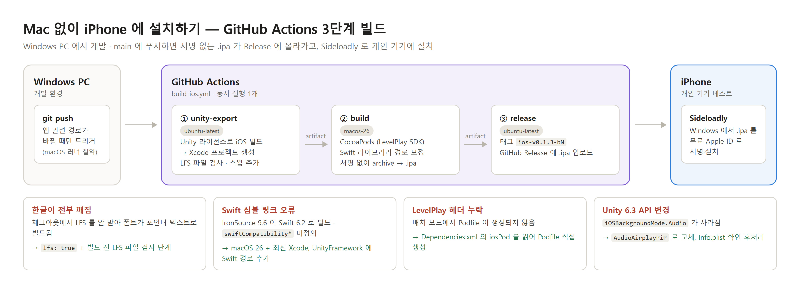

Windows PC만으로 개발하면서 iOS 기기 테스트를 하려고, `main`에 푸시하면 **Linux에서 Unity로 Xcode 프로젝트 생성 → macOS 러너에서 서명 없이 .ipa 빌드 → GitHub Release 업로드** 3단계가 돌게 만들었습니다. 설치는 Windows에서 Sideloadly로 합니다. 앱에 들어가는 경로가 바뀔 때만 실행해 macOS 러너 사용량을 아꼈습니다.

**결과:** Mac 없이 만든 .ipa를 실제 iPhone에 설치해 화면 꺼짐 재생과 잠금화면 컨트롤까지 확인했습니다 (위 스크린샷은 모두 이 빌드로 찍었습니다).

부딪힌 문제와 해결:
- **한글이 전부 깨짐** — 체크아웃에서 LFS를 받지 않아 폰트가 포인터 텍스트로 빌드됨 → LFS 체크아웃 + 빌드 전 LFS 파일 검사 단계 추가
- **Swift 심볼 링크 오류** — 광고 SDK(IronSource 9.6)가 Swift 6.2로 빌드됨 → macOS 26 + 최신 Xcode, UnityFramework에 Swift 라이브러리 경로 추가
- **광고 SDK 헤더 누락** — 배치 모드에서 Podfile이 생성되지 않음 → `Dependencies.xml`을 읽어 Podfile 직접 생성
- **Unity 6.3 API 변경** — `iOSBackgroundMode.Audio` 제거 → 대체 값으로 교체, 빌드 후처리로 Info.plist 확인

---

## 콘텐츠 제작 파이프라인 — 예문 500개, 음성 3,700개, 비용 0원

- **TTS 엔진 선정** — 무료 · 로컬 실행 · 영어와 한국어를 한 모델로 · 상업 이용 가능한 **Supertonic-3**을 골랐습니다. 라이선스(OpenRAIL-M) 원문을 확인해 "AI 생성 음성 고지" 의무를 출시 체크리스트에 넣었습니다.
- **목소리 설계** — 말하기는 여성 1명, 대화는 A 여성 / B 남성. 속도 1.0 한 벌만 만들고 빠르기는 앱에서 조절합니다 (파일 수 절반 이하, 품질 일정).
- **`generate_tts.py`** — 파일별 문장·목소리·설정을 manifest에 기록하고 **바뀐 문장만 다시 생성**합니다. 50개마다 저장해 중간에 끊겨도 이어서 생성 (CPU 4코어 기준 3,330개 약 70분).
- **`validate_content.py`** — 스키마 · id 규칙 · 레벨별 단어 수/문장 수/턴 수 · mp3 누락 검사. 배포 후에는 사이트의 3,801개 파일이 로컬과 크기까지 일치하는지 전수 확인했습니다. 철자를 읽는 대화("M-I-N-A")처럼 TTS가 틀리기 쉬운 문장은 교체했습니다.

---

## 개발 방식

- **결정을 문서로 남기기** — 기획서(v0.1 → v0.4), 작업 기록(WORKLOG)에 "무엇을 왜 그렇게 정했는지"를 표로 기록했습니다. 예: 엔진을 네이티브(Kotlin)에서 Unity로 바꾼 이유, 고정 재생 패턴 대신 듣기 시퀀스를 택한 이유, 50개 → 500개로 분량을 늘린 이유.
- **에디터 자동화** — 처음 열면 TMP 리소스·폰트 에셋·번들 예문·Player Settings·씬을 자동으로 셋업하고, UI 프리팹은 생성기(`UIPrefabBuilder`)로 같은 배치를 다시 구울 수 있게 했습니다. 아이콘·둥근 사각형은 SDF로 그린 PNG를 코드로 굽습니다.
- **UI** — 리퀴드 글래스 스타일(Translucent Image + Paraform), 밝은/어두운 테마, 세로 전용, 노치·제스처 바를 피하는 Safe Area 레이아웃.

---

## 숫자로 보기

| 항목 | 값 |
| --- | --- |
| 레벨 / 유닛 / 예문 | 10 / 100 / 500 |
| 음성 파일 | mp3 3,700개 · 약 111MB · 영어 107분 + 한국어 115분 |
| 서버 비용 | 0원 (GitHub Pages) |
| 지원 플랫폼 | Android (minSdk 26, ARM64) · iOS (실기기 설치·동작 확인) |
| 코드 | C# 8.2k · Java 0.9k · Objective-C++ 0.8k · Python 0.25k 줄 |

---

## 회고와 다음 단계

**배운 점**
- 엔진의 한계(백그라운드 정지)를 우회하려고 엔진 안에서 버티기보다, **OS가 원래 제공하는 방식(미디어 서비스)에 맡기고 엔진은 지시만** 하게 나누는 편이 훨씬 단단했습니다. 이 구조 덕분에 레벨 전체 듣기를 네이티브 수정 없이 추가할 수 있었습니다.
- "화면이 꺼진 동안 무슨 일이 일어나는가"를 기준으로 설계하니 콜백 대신 폴링, 텀도 무음 재생 같은 결정이 자연스럽게 나왔습니다.
- 무료 인프라의 한도(Pages 트래픽, LFS 미지원)를 먼저 숫자로 계산하고 구조를 정하는 것이 중요했습니다.

**남은 일**
- 최근 앱 목록에서 앱을 지우면 재생이 멈춤 (Unity가 액티비티 종료 시 프로세스를 끝냄) → 재생 서비스를 별도 프로세스로 분리
- 제조사별 절전 정책(삼성·샤오미) 장시간 재생 테스트, 배터리 최적화 안내
- 수면 타이머, 진행률·오늘의 유닛, 텍스트 크기
- 출시 준비: AI 음성 고지 문구, 스토어 자료, 예문 원어민 감수
